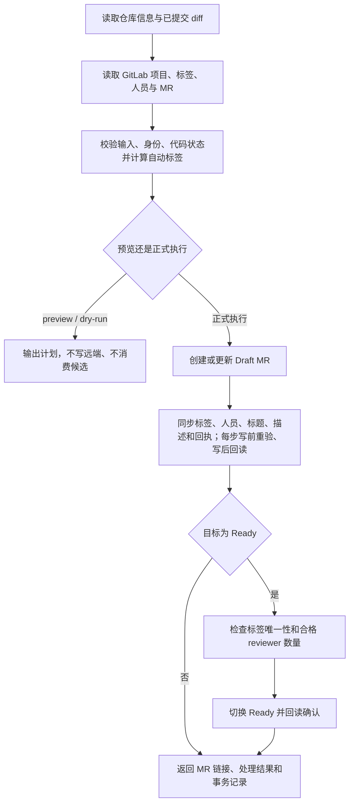

# MR 工具提速：目标、工作记录与当前进度

更新日期：2026-11-04，Asia/Shanghai。

本文记录本次任务的目标、已落地代码、验证证据、未完成工作和接续步骤。它是进度与交接记录，不是发布说明，也不代表已经完成提速验收。

**最新分支保存记录：** 用户随后要求“新开个分支提交下”，已从当前 `main` 的 `2c6b681` 创建 `codex/mr-submit-performance`，用于提交保存本轮源码、测试与本文。以下第 1–13 节保留整理时的进度快照，其中“当前 main”“未提交”等描述对应创建此分支之前；最新保存范围和验收边界见第 14 节。实际提交结果以该分支 Git 日志为准。

## 1. 当前进度结论

**目前做到：根据本地 Git 引用完成分支比较，定位到 MR 提交过程中重复扫描仓库、重复发现完整 GitLab 上下文的开销，并在当前 `main` 工作区实现第一轮去重与 Draft 快照复用。**

**目前尚未做到：把优化接入领先的分支、通过完整默认生产路径的验证、给出真实 GitLab 提交的前后耗时对比，以及构建并验证用户实际使用的工具。**

因此，当前状态是“第一轮实现已在工作区，局部验证已有结果，最终验收未完成”。不能把“已改代码”或“部分测试通过”写成“提交慢的问题已彻底解决”。

| 工作项 | 当前状态 | 证据或限制 |
| --- | --- | --- |
| 确认实际仓库位置 | 已确认 | Git 仓库位于 `aitool-code/harness-mrtool` 子目录 |
| 比较本地已知分支 | 已完成 | 最新提交时间的跟踪分支领先 `main` 175 个提交 |
| 确认远端服务器此刻最新分支 | 本次整理未执行 | 本文未通过新一轮 `fetch` 或远端查询更新分支列表 |
| 判断最适合承接优化的基线 | 已有候选，未完成验收 | 领先分支为候选；提交较新不等于已经验证最稳定 |
| 定位重复工作 | 已定位到具体调用链 | `fresh()`、完整上下文读取、MR 事务读写链 |
| 第一轮性能优化 | 已写入工作区 | 修改 1 个源码文件，新增 1 个单测文件 |
| 专项单测及适配器层集成测试 | 本轮 39 / 39 通过 | 通过范围与默认生产装配链存在差别，详见验证章节 |
| 默认生产装配路径验证 | 本轮代表用例仍失败 | 受 Windows ACL 前置校验阻挡，本次为 `execution stage` |
| API / Git 调用次数对比 | 尚未完成 | 当前没有新增调用计数断言或完整测量报告 |
| 真实提交耗时对比 | 尚未完成 | 没有可据此宣称提速百分比的数据 |
| 移植、构建、安装与发布 | 尚未完成 | 改动仍在 `main`，未提交、未推送、未打包 |

## 2. 用户原始目标与完成标准

原始需求是：

> 分析一下哪个分支是最对最新的；现在 MR 提交用这个工具很慢，定位下原因，慢的环节能省则省，希望能够快速提交代码。

随后用户多次要求继续，并要求将当前目标、做过的工作、进展程度尽可能详细整理为 Markdown 文档。

本任务的目标包含四个部分，不能只完成其中的文档或代码修改就视为整体完成：

1. **确定分支基线。** 说明哪个分支更新、与当前分支是什么包含关系，以及是否适合承接后续修改。
2. **定位慢在哪里。** 找到真实执行链中的重复本地工作、重复网络请求和可以合并的读写步骤。
3. **减少提交成本。** 在可验证的范围内去掉重复执行，把用户常用 MR 提交路径变快。
4. **证明最终可用。** 验证默认 CLI 路径，记录性能前后对比，并确认用户使用的版本包含这些优化。

本次整理的交付物是本文；原性能优化任务仍有后续工作。

## 3. 仓库与工作区现状

### 3.1 目录
上层项目目录：

```text
C:\Users\lxc\Documents\Codex\projects\Luban\aitool-code
```

实际 Git 仓库：

```text
C:\Users\lxc\Documents\Codex\projects\Luban\aitool-code\harness-mrtool
```

执行 `git status`、`git diff` 和项目验证时应在实际仓库目录进行。此前在上层目录执行 Git 命令出现过 `not a git repository`；已确认是目录问题，不是仓库损坏。

### 3.2 当前基线

| 项目 | 当前值 |
| --- | --- |
| 当前分支 | `main` |
| 当前 HEAD | `2c6b681631f9630c0ab7bd4f5d08ec95554406ae` |
| 当前提交时间 | 2026-09-18 15:53:55 +08:00 |
| 当前提交标题 | `fix: freeze update lock capabilities` |
| 当前 `package.json` 版本 | `0.1.6` |
| 包声明的 Node 版本 | `24.16.0` |
| 本次整理检测到的运行时 | Node `v24.22.1` |

本次整理开始时 `git status --short` 的实际结果为：

```text
 M src/cli/default-write-services.ts
?? test/unit/transaction-snapshot.test.ts
```

新增本文之后，还会多出本文这一未跟踪文件。源码改动没有提交，当前没有本次优化对应的提交哈希。

## 4. 分支分析结果

### 4.1 本地已知分支排序

以下数据来自本地 Git 的分支与远端跟踪引用。**远端跟踪引用是本地保存的记录，不代表 2026-11-04 此刻远端服务器已经重新确认的状态。**

| 分支 / 引用 | 提交 | 提交时间 +08:00 | 说明 |
| --- | --- | --- | --- |
| `origin/codex/release-closure-20260918` | `704a9dd` | 2026-09-20 20:58:49 | 本地已知提交时间最新的分支 |
| `main` | `2c6b681` | 2026-09-18 15:53:55 | 当前工作区所在分支 |
| `origin/main` | `2c6b681` | 2026-09-18 15:53:55 | 本地记录中与当前 `main` 相同 |
| `origin/release-candidate-0.1.0` | `2eea0ba` | 2026-09-14 22:11:26 | 比上述分支旧 |
| `origin/publish/cli-release-pipeline-v2` | `d276e77` | 2026-08-23 11:14:34 | 较旧的发布流水线分支 |
| `origin/publish/cli-release-pipeline` | `e0da20f` | 2026-08-21 17:09:53 | 更早的发布流水线分支 |

领先分支的完整提交为：

```text
704a9dd0ee4b4044541ae48440c93559d784c589
test: align packaged readiness with 0.1.7
```

### 4.2 与 main 的关系

已执行并核对：

```powershell
git rev-list --left-right --count main...origin/codex/release-closure-20260918
# 0    175

git merge-base --is-ancestor main origin/codex/release-closure-20260918
# exit code: 0
```

这说明：

- 本地记录中，领先分支完整包含当前 `main`。
- `main` 没有领先分支未包含的额外提交。
- 领先分支在 `main` 基础上增加了 175 个提交。
- 领先分支 `package.json` 中的版本已经是 `0.1.7`。

### 4.3 能得出的结论及尚未做的工作

**能确认的是：本地已知分支中，`origin/codex/release-closure-20260918` 更新，且包含当前 `main`。**

**尚不能确认的是：它已经完成发布验收，或者它就是当前服务器上最正确、最稳定的分支。** 本次没有对这 175 个提交做完整审计，也没有在该分支重新跑完测试。

还有一个与本次优化直接有关的事实：领先分支相对 `main` 也修改了 `default-write-services.ts` 和 `production-default-label-flow.test.ts`。因此不能假设当前补丁直接复制过去就已兼容。

目前没有切换分支、合并分支或覆盖这些改动。下一步应先更新远端信息，再以确认后的基线核对并接入优化。

## 5. 已定位的性能开销

### 5.1 fresh() 原先在多个阶段重复做整套检查

写入服务中的 `fresh()` 负责重新发现仓库、检查远端推送状态、读取规范化 diff、读取外部上下文。

一次真实执行包含以下工作：

1. `repository.discover()`：重新发现仓库身份、分支、remote、工作区状态。
2. `repository.planPush()`：确认远端 source 分支仍在准备阶段的 SHA。
3. `repository.readChangeSet()`：重新读取并比较规范化 diff。
4. 有更新确认信息时，再读取 MR 描述以检查确认摘要。
5. `reader.read()`：重新加载完整 GitLab 上下文。
6. 再检查自动选择的标签是否仍绑定到相同身份。

这套流程既用于适配器的 `readCurrentBinding`，也用于候选身份检查，还被每个 mutation 外围的 guard 调用。多个层次各自要求一次新鲜校验，叠加后会重复执行相同工作。

这是已从源码确认的重复执行结构。目前还没有把其中每个 Git 子命令的实际耗时单独统计出来。

### 5.2 完整上下文读取会再次走 getContext()

默认链路为：

```text
default-write-services
  -> ExternalContextReader.read
  -> readExternalContext
  -> getContext
  -> GitLab 项目、分支、标签、用户、Issue、MR、评审信息等查询
```

`getContext()` 并非只读取一个 MR 对象。根据同项目 / 跨项目、是否绑定 Issue、是否已有 MR 等条件，涉及：

- 目标项目身份；跨项目场景还需要源项目身份。
- 目标分支 SHA。
- 标签 inventory；底层可能包含 REST / GraphQL 及分页请求。
- 用户列表与当前用户。
- 可选 Issue。
- 可选 MR。
- 已有 MR 的审批与讨论状态。
- 收尾时再核对目标项目和目标分支 SHA。
- 候选对象构造、快照校验、绑定信息构造等本地处理。

其中部分查询通过 `Promise.all` 并发执行，不能把它们全部描述为串行；但反复调用整个 `getContext()`，仍会反复支付这一组查询的成本。

### 5.3 事务中的 MR read 又会扩大为完整上下文读取

`GitLabMergeRequestRemote.read()` 先独立读取 MR，再通过 `snapshotReader` 绑定快照。原先默认装配会在这一步再次读取完整上下文。

事务层为了检查并发修改、核对写入结果和恢复不确定的远端结果，会在多个位置读取 MR，包括创建后的回读、标签同步、托管字段写入、描述写入以及 Ready 状态切换。

于是原先常见的成本结构为：

```text
MR 独立读取
  + 完整上下文发现
  + 写入前完整仓库 / 上下文校验
  + mutation
  + MR 独立回读
  + 再次完整上下文发现
```

**第一轮优化的主要落点是减少后面附带的完整发现，而不是删除所有 MR 读写步骤。**

### 5.4 尚未证实的慢点

以下方面目前没有足够测量数据，不能写成已经确认的主要根因：

- 工具启动、版本检查或自动更新耗时。
- DNS、网络往返和 GitLab 服务器响应时间。
- 具体哪个 REST / GraphQL API 在实际项目中最慢。
- Git diff、秘密扫描、仓库检查分别占多少时间。
- 模板加载、验证回执落盘、Windows ACL 校验在正常机器上的耗时。
- 用户日常实际走的是 Draft、Ready、upsert 还是其他入口。

这些是后续端到端计时需要覆盖的环节。当前的结论属于“源码级定位到重复开销”，尚不等同于完成真实生产性能剖析。

## 6. 已写入工作区的优化

### 6.1 文件清单

| 文件 | 状态 | 内容 |
| --- | --- | --- |
| [default-write-services.ts](C:/Users/lxc/Documents/Codex/projects/Luban/aitool-code/harness-mrtool/src/cli/default-write-services.ts) | 已修改，未提交 | 新增快照合成函数，缓存阶段校验结果，接入 Draft 快速路径 |
| [transaction-snapshot.test.ts](C:/Users/lxc/Documents/Codex/projects/Luban/aitool-code/harness-mrtool/test/unit/transaction-snapshot.test.ts) | 已新增，未跟踪 | 2 个快照合成专项测试，文件 95 行 |
| 本文 | 本次新增 | 记录目标、进度、限制和后续步骤 |

当前源码文件的 `git diff --numstat` 为 `79` 行增加、`1` 行删除。未跟踪的新测试不计入普通 `git diff --stat`，因此不能据此遗漏它。

### 6.2 新增 mergeExternalContextSnapshot()

该函数尝试把独立 MR API 读取到的最新对象，合并到当前事务已经准备好的外部上下文快照中。

合成前检查：

- MR 的目标项目 ID 与基础快照一致。
- MR 的源项目 ID 与基础快照一致。
- MR 的源 SHA 与基础快照一致。
- assignee 不超过当前模型支持的一个人。
- MR 上每个标签名称在基础候选集中能唯一对应到一个标签 ID。
- 合成后的标签 ID 不重复。
- 作者、assignee、reviewer 均能对应到基础用户候选中的 ID、用户名和显示名称。

合成时更新：

- MR IID、作者、生命周期。
- 已应用标签 ID。
- assignee、reviewer。
- MR metadata 已读取状态。
- MR API 返回的 pipeline 状态。

合成后仍调用快照验证器。函数无法绑定身份或验证失败时返回 `null`，调用方回退完整上下文读取。

该函数保留基础快照中的候选集、Issue、local checks、review 等字段。特别是审批和讨论信息不会因为合成而重新查询；这也是目前只将其接入 Draft 路径的重要边界。

### 6.3 缓存同一命令内的阶段校验

新增三个事务内状态：

```text
latestSnapshot
preMutationValidationDone
postMutationValidationDone
```

`mutationStarted` 用于区分首次远端 mutation 前后。

当前实现效果：

1. 首次 mutation 之前，已经执行过的完整 `fresh()` 可以被后续调用复用。
2. 在 `findOpen()` 返回后、尚未 mutation 时，让前置校验缓存失效，以捕获查找期间的漂移。
3. 首次 mutation 之后，下一次 guard 调用 `fresh()` 时仍执行一次完整校验。
4. 后续 guard 复用这一阶段的结果，不再每次都完整扫描 Git 和读取整个上下文。

这里的“首次 mutation 后保留一次”指的是**后续 guard 再次触发 `fresh()` 时**。它不是新增了一个必然在事务结束运行的全量收尾检查；不能把两者混为一谈。

### 6.4 Draft 的 MR 读取改用可合成快照

当前快速路径的条件是：

```text
mutationStarted === true
request !== null
request.intent === "draft"
```

满足时，`snapshotReader` 优先合成 `latestSnapshot` 与最新 MR 对象；合成成功便省略这一次完整上下文发现。

以下情况仍读取完整上下文：

- 首次 mutation 前的快照读取。
- Ready 请求的快照读取。
- Verify 请求的快照读取。
- Draft 快照合成无法可靠绑定身份。

需要精确区分：**Ready / Verify 的 MR 快照读取保留完整路径，但 `fresh()` 缓存本身并没有限定为 Draft。** 因而仍需验证缓存对 Ready 等流程的整体影响，不能笼统声称这些流程的所有行为完全不变。

### 6.5 第一轮没有省略的工作

- 实际的 GitLab mutation。
- 独立 MR 读取及写后回读。
- 事务层的字段一致性、结构和身份检查。
- 标签实际增加 / 删除。
- 描述渲染、写入与验证回执相关流程。
- Ready / Verify 所依赖的完整快照读取。Ready 切换检查标签唯一性和合格 reviewer 数量；CI、审批、讨论状态属于 verify --level merge 的检查。
- 失败后的恢复、补偿和审计流程。

因此这是一轮“消除多层重复发现”的实现，尚未把完整提交事务压缩为一次请求。

## 7. 验证记录与证据边界

### 7.1 已有通过记录

本会话先前执行输出中有以下结果：

| 检查 | 结果 | 能证明什么 |
| --- | --- | --- |
| TypeScript 类型检查 | 通过 | 当前修改没有被类型检查发现的问题 |
| `transaction-snapshot.test.ts` | 2 / 2 通过 | 覆盖一个正常合成例和一个未知标签回退例 |
| `production-write.test.ts` | 37 / 37 通过 | 适配器与事务层的候选、审计、绑定及读写行为在该测试中通过 |
| `git diff --check` | 通过 | 已跟踪源码修改未发现 diff 空白错误 |

**计数澄清：37 个生产写入测试 + 2 个专项单测 = 39 个；不能写成 `production-write.test.ts` 自身通过了 39 个。**

这些记录不能外推为全量测试、打包测试、默认生产装配链以及真实 GitLab 提交全部通过。

### 7.2 两个新测试的实际范围

新增测试名称：

1. `merges a live MR read into the prepared context without another context discovery`
2. `falls back when a live MR label cannot be bound to the prepared context`

第一个测试直接调用合成函数并检查返回字段。它没有运行完整 CLI，也没有对上下文 reader 或 GitLab API 做调用次数断言。测试名称中的“无需再次 discovery”描述的是函数使用方式，不能作为整个提交流程已经减少多少请求的实测证据。

第二个测试也只检查 helper 返回 `null`，没有实际调用默认 `snapshotReader`，所以还不能单独证明完整 reader 的回退调用与回退成功。

此外，已有测试的层次需要区分：

- `production-write.test.ts` 为适配器注入 `readCurrentBinding` 和 `verifyLiveCandidateIdentities`，没有直接执行本次修改的默认 `fresh()` 实现。
- `default-write-services.test.ts` 目前主要检查延迟构造及在 `LABEL_ERROR` 提前退出的场景，没有覆盖成功事务的缓存调用次数；本轮没有运行该文件。
- `mr-transaction.test.ts` 主要使用 fake remote 验证事务语义，不能替代默认生产装配链；本轮没有运行该文件。

当前新增测试还没有覆盖：

- `fresh()` 缓存何时命中、何时失效。
- 首次及后续 mutation 之间的仓库变化。
- 创建、更新、upsert、dry-run 的默认装配调用次数。
- source / target 项目、SHA、用户改名、同名标签、多 assignee 等全部回退边界。
- Ready / Verify 与缓存相互作用。
- 实际耗时或真实网络请求减少量。

### 7.3 默认生产路径的 ACL 障碍

先前运行 `production-default-label-flow.test.ts` 时，失败集中在临时状态目录的 Windows ACL 验证：

```text
Windows ACL verification failed at owner-other stage
```

该类失败发生在签发候选上下文和进入 MR 提交逻辑之前。其本身不能证明本次优化存在提交逻辑错误，但也意味着这些测试没有实际覆盖到本次修改的默认装配链。

需要继续区分：

- “在前置 ACL 校验阶段失败”，是已经观察到的失败位置。
- “全部默认生产逻辑正确”，并没有因此得到证明。
- “ACL 一定只是测试机器问题，与任何实现都无关”，仍需对目录权限、用户和校验器进一步核实，不能仅靠推断定论。

本次文档整理重新执行了一个代表性默认创建用例，仍然失败，但本次错误阶段与历史记录不同：

```text
Private state path is unsafe: Windows ACL verification failed at execution stage
```

本次堆栈的关键链路为：

```text
production-default-label-flow.test.ts:170
  -> issue() 签发候选上下文
  -> getContext
  -> CandidateContextStore.locked / acquireLock
  -> ensurePrivateStateDirectory
  -> state-path.ts:143 的 Windows ACL verifier
```

历史为 `owner-other`，本次为 `execution`。可以确认两次都停在状态目录 ACL 前置检查；尚不能确认它们的底层原因完全相同。本次未为绕过失败而关闭 ACL 校验。

### 7.4 本次整理的最新复核

以下是 2026-11-04 本轮实际执行并读到完整结束结果的检查：

| 命令 / 检查 | 实际结果 | 解释 |
| --- | --- | --- |
| `node --version` | `v24.22.1` | 本轮实际运行时，不是包声明的精确版本 |
| `node node_modules/typescript/bin/tsc --noEmit` | 退出码 0 | 类型检查通过；无错误输出 |
| 同时执行专项单测和适配器集成测试 | 退出码 0；39 tests，39 pass，0 fail | 其中新单测 2 个，适配器测试 37 个 |
| 上述测试报告的总时间 | `81069.3557 ms`，约 81.07 秒 | 测试进程耗时，不能视为真实 MR 提交耗时 |
| 默认生产创建代表用例 | 退出码 1；1 test，0 pass，1 fail | 状态目录 ACL `execution stage` 失败 |
| 该默认创建测试报告的总时间 | `42703.393 ms`，约 42.70 秒 | 同样不代表 MR 提交耗时，尚未进入提交逻辑 |
| 分支祖先关系 | 退出码 0 | 当前 `main` 是本地已知领先分支的祖先 |
| 分支左右提交计数 | `0 175` | 当前 `main` 无独有提交，领先分支多 175 个 |
| 整理开始时 `git diff --check` | 退出码 0 | 对已跟踪源码 diff 的空白检查通过 |

本轮没有运行全量测试、打包测试，也没有调用真实 GitLab 创建或更新 MR。

### 7.5 工具链方面遇到的问题

- 此前环境中直接执行 `npm run typecheck` 提示 `npm` 不在 PATH。
- 尝试 `pnpm run typecheck` 时，环境提供的 fallback 会先触发依赖安装和策略检查；随后因 `esbuild` build scripts 策略失败，没有完成该方式的 typecheck。
- 该尝试生成过 `pnpm-lock.yaml` 和 `pnpm-workspace.yaml`；已经清理，当前未将它们留在改动中。
- 后来直接使用项目现有 TypeScript 编译器执行检查，已有通过记录。
- 先前验证时运行时为 Node `v24.19.0`；本次整理检测为 `v24.22.1`，均与项目声明的精确版本 `24.16.0` 不一致。

后续发布或完整兼容性验收应按项目要求核对运行时，不应把另一版本上的局部通过作为正式打包验收。

## 8. 尚需核对的正确性与接入问题

本节把源码可确定的行为收缩与尚需实跑验证的风险分开描述。当前没有因这些观察而继续修改实现，仍保留第一轮补丁供后续核对。

### 8.1 校验缓存带来的时序窗口

`fresh()` 缓存会跨越若干 `await`。如果候选读取、消费或其他异步步骤之间仓库或候选发生变化，是否仍能在首次 mutation 前捕获，需要默认装配路径的专门测试。

当前 `findOpen()` 后主动使缓存失效，已针对其中一个窗口做处理；不能据此认为所有入口和所有异步窗口都已覆盖。

### 8.2 事务后半段的仓库漂移检测

当前在 mutation 开始后只执行一次完整阶段校验，后续 mutation 不再每次重新读规范化 diff。

这会改变原来逐次重验的频率。需要明确后续阶段依靠哪些身份、SHA、事务读回约束，补充对后半段漂移的测试，并核对仓库已有测试和约定。

从源码可以确定，后续 mutation guard 不再重新发现本地 HEAD、工作区、push plan 或 changeSet 的变化；MR 的独立读回不能代替本地仓库检查。原注释中的“写前重新发现”也需要与实际执行频率保持一致。

### 8.3 标签名称映射与 REST ID 交叉验证

新函数主要通过标签名称查找候选 ID，`GitLabMergeRequestRemote` 后续仍会将绑定的 ID 与 MR 返回的 REST ID 交叉验证。

因此必须验证同名标签重建、作用域变化等场景：名称相同但 ID 不同，可能由后续校验拒绝，而不一定在合成函数中得到 `null` 并自动回退。不能声称所有身份变化都已经通过平滑回退处理。

### 8.4 快照保留字段的新鲜度

合成快照保留基础 `review`、Issue、候选集和 local checks。Draft 与 Ready 的要求不同，必须确认 Draft 后续描述、回执及 Verify 对这些字段的预期一致。

源码中 Draft 也可以通过策略设置非零的最小合格 reviewer 数量。用户 membership 或 reviewer qualification 改变，但 MR 返回的用户 ID / 名称未变时，快路径不会仅凭 MR 对象观察到这些变化。是否允许接受这种事务内快照，需要明确并测试。

### 8.5 标签候选清单的变化不能被单个 MR 对象完整观察

这是本次只读复核确认的观察范围收缩：最后一次完整发现之后，如果 inventory 中新增了会造成歧义的同名标签，而 MR 的已应用标签响应不变，helper 只读取旧 `base.labelCandidates` 与当前 MR，无法观察这个新增候选。

完整 `labelInventory()` 原本会读取当前标签 inventory，并对不唯一的有效名称报错；事务中的 `assertRemoteIdentity()` 也要求相关生命周期标签名称保持唯一，但它现在可能看到的是复用的候选清单。

因此不能仅凭 MR 回读断言“完整标签 inventory 始终没有歧义”。需要补充默认路径回归，决定保留哪一级轻量重验或调整缓存边界。当前没有生产装配层实跑复现，不能宣称该边界已经关闭。

### 8.6 缓存返回对象并非来自同一次完整读取

缓存命中时返回形如 `{ ...live, snapshot: latestSnapshot }` 的对象。更新的是 `snapshot`，其余 `binding`、`candidates`、`audit` 仍来自初始 `live`。

需要核对所有消费方对这些字段的关系假设，不能把这个对象描述成“所有字段都来自最新一次 live discovery”。

### 8.7 在领先分支上的兼容性

领先分支同时改过写入服务及生产默认流程测试，当前优化尚未在它上面编译或运行。需要逐项合并实现与行为要求，不能只按当前 `main` 的测试结果验收。

## 9. 性能效果：当前能说与不能说的内容

当前能说的是：

- 代码已经加入事务内阶段缓存。
- Draft 的部分 MR 读回已具备省略完整上下文发现的路径。
- 完整 Git / context 检查不再由所有后续 guard 无条件重复执行。

当前不能说的是：

- “从几分钟降到几秒”。
- “提升了某个百分比”。
- “每次创建固定减少多少请求”。
- “所有提交入口都更快”。
- “用户已经用上这个版本”。

因为目前缺少同一仓库、相同 MR 类型、相同网络条件下的前后计时，也缺少默认流程的调用计数证据。

后续至少记录以下项目：

| 指标 | 当前状态 | 建议记录方式 |
| --- | --- | --- |
| CLI 启动到进入准备阶段 | 未测量 | 分阶段计时 |
| 仓库 discover 次数与耗时 | 未计数 | 包装注入的 repository 方法 |
| planPush 次数与耗时 | 未计数 | 同上 |
| 规范化 diff 读取次数与耗时 | 未计数 | 同上 |
| 完整 context discovery 次数 | 未计数 | 包装 ExternalContextReader |
| 各 GitLab API 次数与耗时 | 未汇总 | 结合客户端审计与请求计时 |
| Draft 创建总耗时 | 未进行前后对比 | 同一输入、同一环境比较 |
| Draft 更新 / upsert 总耗时 | 未进行前后对比 | 分别比较，避免混合统计 |
| Ready / Verify 总耗时 | 未进行前后对比 | 验证仍满足状态门禁 |
| 出错、重试与补偿路径 | 未进行性能验收 | 保留必要的结果确认 |

测量时应使用可重复 fixture / mock 调用计数先验证结构变化，再在已授权的测试项目做真实端到端计时，避免把本地测试进程耗时当作真实 MR 提交耗时。

## 10. 后续接续步骤

建议按以下顺序继续，先补足当前缺口，再扩大优化范围。

### 第一步：确认远端与开发基线

1. 保留当前未提交源码、新测试与本文。
2. 确认当前工具仓库自己的 remote 和开发约定。
3. 刷新远端引用，重新核对是否仍由 `codex/release-closure-20260918` 领先。
4. 审阅候选基线中的写入服务与默认生产测试差异。
5. 在适当分支或隔离工作区接入优化，记录最后承接修改的 commit。

### 第二步：补齐默认装配测试

1. 定位或隔离 Windows ACL 前置失败，保留权限校验本身的测试。
2. 跑通默认创建、更新、upsert、dry-run、Ready、Verify 的相关用例。
3. 给缓存命中、失效、首写前漂移、后续漂移补测试。
4. 给快照合成的身份边界与回退补测试。
5. 确认调用次数确实下降，而非把工作移动到其他重复路径。

### 第三步：测量并继续压缩开销

1. 先对原版与修改版做相同 fixture 的调用次数比较。
2. 记录 Git 操作、上下文发现、单个 MR 读写的耗时。
3. 按真实耗时排序，继续合并重复步骤。
4. 核实是否仍需要事务中每个前读 / 后读，以及哪些可以复用已确认结果。
5. 分别记录 Draft、Ready 和 upsert，避免用最快入口代表所有提交。

### 第四步：交付可实际使用的版本

1. 在正确基线上完成类型、相关集成、构建和必要回归验证。
2. 记录最终改动与已知限制。
3. 构建对应 CLI / 分发产物，确认用户日常调用的入口指向包含优化的版本。
4. 按用户后续授权和仓库流程执行提交、推送或发布。

截至本文，尚未执行本次优化的 commit、push、MR 创建、安装替换或正式发布。

## 11. 复现与核对命令

以下命令在实际仓库根目录执行。它们是本次核对所用命令或后续复核入口，不表示未跑过的检查已经通过。

```powershell
Set-Location 'C:\Users\lxc\Documents\Codex\projects\Luban\aitool-code\harness-mrtool'

git status --short
git branch --show-current
git rev-parse HEAD
git diff -- src/cli/default-write-services.ts
git diff --check

git for-each-ref --sort=-committerdate --count=10 --format='%(refname:short) %(objectname:short) %(committerdate:iso8601)' refs/heads refs/remotes
git rev-list --left-right --count main...origin/codex/release-closure-20260918
git merge-base --is-ancestor main origin/codex/release-closure-20260918

node --version
node node_modules/typescript/bin/tsc --noEmit

node --test --import tsx test/unit/transaction-snapshot.test.ts test/integration/production-write.test.ts

node --test --import tsx --test-name-pattern='production main default create writes and reads back exactly three automatic labels with no caller label tokens' test/integration/production-default-label-flow.test.ts
```

本次没有执行新的远端刷新；后续需要远端最新结论时，应单独执行并记录 `git fetch` 或相应远端查询结果。

## 12. 关键源码与证据入口

| 入口 | 用途 |
| --- | --- |
| [写入服务与快照合成](C:/Users/lxc/Documents/Codex/projects/Luban/aitool-code/harness-mrtool/src/cli/default-write-services.ts:46) | 本次实际源码变更 |
| [阶段校验 fresh()](C:/Users/lxc/Documents/Codex/projects/Luban/aitool-code/harness-mrtool/src/cli/default-write-services.ts:154) | 仓库 / diff / context 重验及缓存 |
| [Draft 快速快照入口](C:/Users/lxc/Documents/Codex/projects/Luban/aitool-code/harness-mrtool/src/cli/default-write-services.ts:221) | 合成成功省略完整上下文发现 |
| [完整外部上下文 reader](C:/Users/lxc/Documents/Codex/projects/Luban/aitool-code/harness-mrtool/src/app/external-context.ts) | reader.read 到 getContext 的关系 |
| [getContext](C:/Users/lxc/Documents/Codex/projects/Luban/aitool-code/harness-mrtool/src/app/get-context.ts:270) | 项目、分支、标签、用户及评审查询 |
| [GitLab MR 绑定与独立读取](C:/Users/lxc/Documents/Codex/projects/Luban/aitool-code/harness-mrtool/src/gitlab/mr-remote.ts:292) | MR read、快照身份及标签 ID 核验 |
| [命令适配器](C:/Users/lxc/Documents/Codex/projects/Luban/aitool-code/harness-mrtool/src/cli/commands/merge-request.ts) | 候选预检、消费、mutation gate、审计证明 |
| [创建事务](C:/Users/lxc/Documents/Codex/projects/Luban/aitool-code/harness-mrtool/src/app/create-mr.ts) | 查找、Draft 创建、标签、字段、描述和 Ready |
| [更新事务](C:/Users/lxc/Documents/Codex/projects/Luban/aitool-code/harness-mrtool/src/app/update-mr.ts) | 更新前读、写入及状态转换 |
| [单步写前读取、写后回读和补偿](C:/Users/lxc/Documents/Codex/projects/Luban/aitool-code/harness-mrtool/src/app/compensate.ts:233) | 独立读取仍然保留，未因本次优化减少实际 mutation |
| [完整标签 inventory 的歧义检查](C:/Users/lxc/Documents/Codex/projects/Luban/aitool-code/harness-mrtool/src/gitlab/client.ts:613) | 与缓存候选清单的观察范围差异 |
| [默认生产装配](C:/Users/lxc/Documents/Codex/projects/Luban/aitool-code/harness-mrtool/src/cli/production-runtime.ts) | 默认写入服务的接入位置 |
| [Windows 状态目录权限检查](C:/Users/lxc/Documents/Codex/projects/Luban/aitool-code/harness-mrtool/src/platform/state-path.ts:143) | ACL 失败位置 |
| [专项新测试](C:/Users/lxc/Documents/Codex/projects/Luban/aitool-code/harness-mrtool/test/unit/transaction-snapshot.test.ts) | 已新增的 2 个测试 |
| [适配器层集成测试](C:/Users/lxc/Documents/Codex/projects/Luban/aitool-code/harness-mrtool/test/integration/production-write.test.ts) | 已有 37 个测试的实际覆盖层 |
| [默认写入服务的已有测试](C:/Users/lxc/Documents/Codex/projects/Luban/aitool-code/harness-mrtool/test/integration/default-write-services.test.ts) | 延迟构造及提前退出覆盖，本轮未执行 |
| [事务层 fake remote 测试](C:/Users/lxc/Documents/Codex/projects/Luban/aitool-code/harness-mrtool/test/integration/mr-transaction.test.ts) | 事务语义参考，本轮未执行 |
| [默认生产流程集成测试](C:/Users/lxc/Documents/Codex/projects/Luban/aitool-code/harness-mrtool/test/integration/production-default-label-flow.test.ts) | 需要补齐的默认 CLI 装配验证 |

## 13. 交接时需要保留的事实

- 不要重新从“是否有 mrtool”开始排查，仓库和相关写入实现已经定位。
- 不要把 `aitool-code` 上层目录误当作 Git 根目录。
- 不要丢弃现有未提交代码与新增测试。
- 不要把“本地记录最新”写成“远端此刻已经确认最新”。
- 不要把 `main` 上的验证写成领先 175 个提交分支上的验证。
- 不要把 39 个合计测试误写成单个集成文件的测试数量。
- 不要把 ACL 前置失败视为已测完提交链路。
- 不要仅凭合成函数的两个测试宣称默认 CLI 提速已经验收。
- 不要在没有计时数据时给出提速倍数或百分比。
- 不要把源码已改、文档已写视为工具已经构建、安装或发布。

当前最有价值的下一步，是在确认后的基线上补齐默认生产装配与调用计数验证，再做真实耗时对比。

## 14. 后续按用户要求创建分支并保存进度

日期：2026-11-04。

用户指令：`新开个分支提交下`。

| 项目 | 保存范围 |
| --- | --- |
| 新建分支 | `codex/mr-submit-performance` |
| 创建基线 | 原本地 `main`，`2c6b681631f9630c0ab7bd4f5d08ec95554406ae` |
| 源码 | `src/cli/default-write-services.ts` 的第一轮缓存与 Draft 快照合成 |
| 测试 | `test/unit/transaction-snapshot.test.ts` 的 2 个专项单测 |
| 文档 | 本文的目标、进度、证据与未完成事项 |
| 提交性质 | 阶段性保存，不是性能问题已经全部修复的发布提交 |

此次新建分支没有接入本地记录领先 175 个提交的 `origin/codex/release-closure-20260918`；不改变第 4、8、10 节记录的待接入与待验证事项。

默认生产测试的 Windows ACL 前置失败、缓存带来的观察范围收缩、真实 API 调用计数与耗时对比尚未完成等限制继续保留。局部类型和测试结果不能代替这些验收。

创建分支后、保存提交之前再次复核：

- 直接运行项目 TypeScript 编译器，退出码 0。
- 重新执行 `transaction-snapshot.test.ts` 与 `production-write.test.ts`，共 39 个测试通过，0 个失败，退出码 0；测试进程报告约 47.11 秒。
- 暂存区 `git diff --cached --check` 通过，范围为表中三个文件。
- 此次保存没有重新运行默认生产创建的 ACL 失败用例，也没有完成全量或真实性能验收；其状态仍以上文记录为准。

本次操作范围是创建本地分支并提交当前进度。本文不把该操作表述为已经 push、创建 MR、合并或发布。提交后可使用以下命令核对实际提交与工作区状态：

```powershell
git branch --show-current
git log -1 --oneline
git show --stat HEAD
git status --short
```


## 15. 本轮修复目标与验收标准

完成 harness-mrtool 的 MR 提交性能修复并交付可复核的本机版本，按以下目标和验收条件逐项完成：

1. 基线与改动隔离：刷新 GitHub 远端；以 codex/release-closure-20260918 的 0.1.7 候选（704a9dd）为基线建立本地 codex/mr-submit-performance-fix，移入 ebf9fc9 的必要工作；保留原分支，记录基线、差异和最终工作区状态，避免丢失 175 个发布候选提交。

2. 修复写前新鲜度回归：去除跨异步步骤复用的前置/后置校验缓存。每次 MR mutation 前重新发现仓库、校验远端源 SHA、规范化 diff 和候选身份。覆盖首次写前、候选消费后、首次写后及后续写入时的 HEAD/diff/工作区/远端变化；Draft 与 Ready 都必须拒绝过期输入，并准确返回未写入或部分写入状态。

3. 修复 Draft 快照过期：去除沿用旧 labelCandidates/userCandidates/review/Issue 的合成路径。每次独立 MR 前读/后读仍读取实时标签、成员资格、Issue、review、项目及目标分支；新增同名未应用标签、标签同名重建、人员身份或资格变化、目标分支漂移都必须被发现。保留 MR REST 标签 ID 与全局 ID 交叉验证。

4. 安全提速：将复用限定为单次完整上下文发现中刚获得的、项目 ID 与 IID 精确匹配的一个 MR 响应；复制并冻结输入，后续读取及其他请求仍访问原客户端，各次/并发调用互不污染。并发执行同一固定仓库快照上的只读 push plan 与 diff 读取。不得把未重验的旧结果当成最新结果。

5. 打通 Windows 默认路径：修复 ACL 校验子进程在缺少 PATHEXT 时无法执行 icacls 的问题，使用可信绝对系统路径和仅子进程环境设置；保留 owner、访问规则、继承、重解析点校验。真实原生测试必须通过，过宽 Everyone 权限仍须被拒绝。

6. 测试验收：使用精确 Node 24.16.0；修复前后运行同一 Git 漂移回归，证明旧提速补丁失败、修复版通过。覆盖默认 CLI create、update、upsert、Draft、Ready、dry-run、verify、标签歧义、人员变更、远端写后回读及错误/部分状态。新增单次 MR 响应复用的隔离、冻结、身份、实时 metadata 和调用计数测试；运行相关既有事务、适配器、外部上下文、真实 Git 和权限回归，给出实际 pass/fail/skip 数量。

7. 性能证据：记录可重复 fixture 中每类完整上下文读取、独立 MR receipt、额外 MR details、标签 inventory、用户和 review 查询，以及每次写前 Git 检查次数。确认重复 MR details/附带项目查询减少，实时校验与回读保持；至少给出 Draft 和 Ready 的具体计数，说明测试范围。区分 fixture 耗时与真实 GitLab 网络耗时，不编造线上加速比例。

8. 构建与可用性：类型检查、diff 空白检查、标准构建通过；验证构建产物的 version/schema/只读或 dry-run 入口。条件允许时生成并验证 Windows 本机可运行产物；确认其源码包含修复且版本/模板信息一致，不以源码测试替代产物检查。

9. 文档与交付：更新仓库进度文档，写明已修复问题、最终 MR 工具自身流程、优化边界、复现命令、测试和请求计数、产物位置与剩余外部验证项。交付本地修复代码、可审阅差异和构建/验证证据。明确真实 GitLab 耗时尚未测得的限制；本轮完成本地修复交付，不自动推送、合并或正式发布。

完成标准：上述本地可执行事项全部有代码/测试/构建证据；没有尚未解释的相关失败；两处已知回归均关闭；不得仅凭若干单测通过或一份进度文档标记完成。


## 16. 0.1.7 基线上的本轮修复与验证

本轮本地分支为 `codex/mr-submit-performance-fix`，基于 `704a9dd0ee4b4044541ae48440c93559d784c589`（CLI 0.1.7），保留发布候选的 175 个提交；原 `codex/mr-submit-performance @ ebf9fc9` 保留。第 1–14 节是此前历史记录，当前实现以本节为准。

### 16.1 实际修复

- 移除了跨异步阶段的前置/后置检查缓存；每次 binding、候选校验和 mutation guard 都重新检查仓库、源分支推送状态、规范化 diff 和完整外部上下文，适用于 Draft 与 Ready。
- 移除了沿用旧候选/资格/Issue/review 的 Draft 快照合成。每次独立 MR 读取仍走完整发现，保留实时 inventory、成员、Issue、review、项目及目标分支 fence 与标签 REST ID 交叉验证。
- 复用仅发生在单次 readExternalContext 内：独立 MR receipt 已取得的对象经过复制和深度冻结，只能满足一次精确的项目 ID + IID 请求；其他读取与后续/并发调用仍访问原客户端。
- 同一已发现仓库快照上的只读 planPush/readChangeSet 改为并发；检查条件保持。两项使用 Promise.allSettled 等待全部结束，再按原顺序传播错误，防止一项失败时另一项 Git 读取仍占用工作区。
- Windows ACL 子进程改用可信绝对 PowerShell/icacls 路径，并仅给子进程指定 PATHEXT=.EXE；owner、规则、继承和重解析点要求保留。

### 16.2 调用计数证据

以下是默认 CLI + 真实 adapter/domain/store/receipt + fake GitLabClient fixture 的成功创建计数；不是分页后的 HTTP 请求总数，也不是实际 GitLab 网络计时。完整上下文发现次数保留，本轮减少的是读回附带的重复 MR 获取。

| 方法 | Draft | Ready |
| --- | ---: | ---: |
| MR 独立 receipt 读取 | 7 | 13 |
| 完整发现额外重复 MR GET | 0 | 0 |
| labelInventory / listUsers | 各 15 | 各 24 |
| getReviewState | 7 | 13 |
| getProject | 30 | 48 |
| discover / planPush / readChangeSet | 各 8 | 各 11 |

对应重复 MR 获取在未复用路径中仍会执行；专项测试用同一客户端对照确认只跳过精确 MR 请求，其他实时请求保持。真实 GitLabClient 的 getMergeRequest 内还会先读取项目，故可避免其附带的重复项目请求；该底层 HTTP 减少量不由上述 facade 计数直接测得。

### 16.3 当前 MR 工具自身流程



Ready 的上述放行条件与 verify --level merge 的 CI、审批、讨论检查不同。本图只记录 MR 工具工作。

### 16.4 构建与外部边界

使用 SHA256 校验过的官方 Node 24.16.0，类型检查、标准构建、Windows SEA 构建通过；EXE 在仓库外运行 version/schema show 成功，报告 CLI 0.1.7 / Template 1.1.0；离线 create 正确拒绝且未写远端。构建回执校验 163 个输入均与当前源码匹配。

尚未对用户的真实 GitLab 项目做网络耗时前后测量，也没有自动推送、合并、替换用户安装或正式发布。本机只有 Codex 缓存中的 Git，生产 GitRunner 的系统可信安装目录要求仍保留；真实 Git 测试需显式给出受控的测试 Git 根和直接原生进程委托，不允许生产回退到任意 PATH 程序。


### 16.5 最终相关验证结果

| 分组 | 用例 | 通过 | 跳过 |
| --- | ---: | ---: | ---: |
| 既有适配器、事务、默认服务、外部上下文回归（不含真实 Git 文件） | 103 | 103 | 0 |
| 真实 Git 创建、dry-run 复用、HEAD/tracking/worktree 漂移 | 5 | 5 | 0 |
| 默认生产标签完整流程 | 20 | 20 | 0 |
| 新增默认生产性能/漂移/并发收尾回归 | 10 | 10 | 0 |
| MR 响应单次复用与 metadata 新鲜度 | 12 | 12 | 0 |
| ACL 与 context store | 51 | 50 | 1 |
| 原始写前漂移隔离回归修复复跑 | 1 | 1 | 0 |
| 真实 Windows ACL 的完整 update 漂移复现 | 1 | 1 | 0 |
| 合计 | 203 | 202 | 1 |

按最终有效用例合并；包含针对失败项的复跑，不表示一次运行的全量测试。真实 Git 文件先有 4 项通过、HEAD 清理 EBUSY 失败；修复并发任务收尾后仅重跑 HEAD，1/1 通过。性能计数两例是上述 10 例的子集，不重复计数。权限测试唯一跳过项为 POSIX 专属。

类型检查和 git diff --cached --check 通过。Windows SEA 构建通过，并在交付目录外运行 version / schema show 成功；offline create 正确拒绝，remoteWrite 为 not-attempted。编译器仍有 2 条既有 import.meta/CJS 警告，产物 smoke 通过；本地 SEA 注入记录签名变化提示，不是正式签名发布件。

测试使用 Node 24.16.0；主要复现入口：

```text
node node_modules/typescript/bin/tsc --noEmit
node --test --import tsx --test-concurrency=1 test/integration/production-default-label-flow.test.ts
node --test --import tsx --test-concurrency=1 test/integration/default-write-performance.test.ts
node --test --import tsx test/unit/transaction-snapshot.test.ts
node --test --import tsx test/unit/windows-acl-verifier.test.ts test/unit/context-store.test.ts
node --test --import tsx test/integration/production-real-git-label-flow.test.ts
node scripts/build-sea.mjs
```

本机真实 Git 测试需设置 HARNESS_MRTOOL_TEST_GIT_EXECUTABLE 为经过确认的绝对 Git.exe 路径；该变量只由测试 fixture 使用，生产工具不消费它。

## 17. 2026-11-06：默认 API、允许本地改动及 HTTP 兼容

第 1–16 节保留此前工作记录；当前分支和本轮交付范围以本节为准。

### 17.1 目标和分支状态

- 工作分支：`codex/mr-submit-performance`，沿用此前用户要求建立并推送的分支。
- `9390ab0` 已移除工作区必须完全干净的阻断，并把默认 MR 操作设为 API；本轮继续在其上修复 GitLab HTTP 兼容。
- 用户要求的“推送最新 mrtool”指向此分支的源码提交。包版本仍为 `0.1.7` 候选；本轮没有正式发布、合并主分支或替换已安装插件。

### 17.2 本地文件不会阻止已提交代码的 MR

仓库发现、推送规划和显式手工交接中的工作区清洁性阻断已删除。暂存、未暂存及未跟踪文件均可保留，包含 `.superpowers` 报告。工具使用已提交的 `HEAD` 计算 MR diff 和推送内容，不自动暂存、stash、清理或删除用户本地文件。

HEAD、目标项目和分支身份、远端源提交以及实际提交 diff 的一致性校验继续执行。它们用于确保提交的是选定的代码；本地存在其他文件不再构成拒绝原因。

默认创建、更新、upsert 和验证均走 API。API 失败会返回对应错误，不自动改用 SSH 创建 MR、浏览器交接或手工流程；手工模式需要用户明确要求。Git remote 的 SSH 分支传输与 GitLab MR API 是两个独立环节。

### 17.3 GitLab HTTP 和 HTTPS 的选择

1. 普通 GitLab 主机允许 `http://` 和 `https://`，不再要求 HTTP 是 loopback 或启用测试例外。
2. remote 明确包含 HTTP/HTTPS 时保留其协议；不在失败后擅自改成另一个协议。
3. SSH/scp/git remote 无 API 协议信息时，优先 HTTP。只读项目查找遇到网络、超时、升级重定向或端点不可用时，可尝试同一主机的 HTTPS。
4. 协议选择仅发生在首次项目读取。选定后，本次会话的读取、MR 写入、回执保存和独立验证都绑定同一 origin；不会跨协议重试写入。
5. 401/403 等认证拒绝直接返回。不会跟随重定向到其他主机。首次回退复用同一凭据，使错误脱敏历史得以保留；后续请求仍可读取轮换后的凭据。

HTTP 支持覆盖底层 REST/GraphQL、CLI 只读规划、MR URL、事务失败回执和持久化验证回执。URL 中的用户名密码、跨 origin、非 HTTP(S) 协议等校验保留。GitHub 更新源和签名发布下载的协议规则不在本轮修改范围。

### 17.4 真实 GitLab 17.10.3 的兼容修复

实际服务位于 `http://yanfa-git.maxphotonics.com`；项目为 `bjxcjg/Luban/03-apps`，ID 为 `258`，默认目标分支为 `develop`。凭据只在验证进程内读取，未写入仓库或打印。

真实读取发现并修复两处响应兼容问题：

- 该版本的 REST 标签未返回 `archived` 字段。缺省按 `false` 处理；明确的 `true`/`false` 保留，null、字符串等畸形值仍拒绝。目录标签、Issue 和 MR 已应用标签均有覆盖。
- 项目标签接口即使传入 `include_ancestor_groups=false`，仍返回带 `is_project_label:false` 的继承标签。此类条目从项目标签列表排除，随后由所属祖先组目录提供，保留 GroupLabel 全局 ID 以及项目同名标签优先级。显式畸形的类型标记仍拒绝。

修复后真实 `labels list` 返回 `OK`，正确识别 GroupLabel、标签分类、默认优先级及生命周期标签。实际业务仓库的未跟踪 `luban-web-wasm/.superpowers/` 保留原状。本次真实服务检查未创建或修改业务 MR。

完整 `context` 还暴露了原生 Windows PowerShell 误加载父进程 PowerShell 7 模块的问题：`Get-Acl` 模块加载失败，导致目录属主被误判为空。修复仅从原生 PowerShell 子进程环境中移除大小写不敏感的 `PSModulePath`，让它加载自己的模块；调用者环境、目录属主和权限校验均保留。先复现失败，再用不兼容模块 fixture 验证修复，既有 Everyone 访问规则拒绝测试继续通过。

最终直接运行标准构建产物 `dist/main.cjs context --no-update --output json`，业务 cwd 为 `03-apps`，使用真实 GitLab、默认状态目录和原有父进程模块环境，返回 exit `0` / `OK`。无依赖替换或权限绕过；成功生成包含 diff、pushPlan、MR plan、标签及人员候选的完整 context，且未跟踪报告仍在。

### 17.5 验证结果

相关回归分组执行，以下为各组最终有效结果；不是全仓库测试套件的一次运行。

| 范围 | 通过 | 跳过 |
| --- | ---: | ---: |
| GitLab client，包括旧版本标签响应兼容 | 59 | 0 |
| HTTP transport、Skill 和插件打包 | 41 | 0 |
| API 会话协议选择、凭据回退及后续轮换 | 26 | 0 |
| 目标项目解析和生产只读命令 | 23 | 0 |
| MR 事务与 transaction journal | 89 | 0 |
| 持久化验证回执 store | 31 | 2 |
| 真实 Git 的 HTTP/HTTPS 创建、更新和存储后独立验证 | 2 | 0 |
| 原生 Windows ACL 与 PowerShell 模块环境兼容 | 4 | 0 |
| 合计 | 275 | 2 |

两项跳过为 Windows 环境的时间戳身份 fence 和不可用的符号链接用例。真实 Git 的两个用例使用真实仓库、生产 GitLabClient、模拟 HTTP 服务和实际回执存储；断言描述确实更新，重新组合的服务可读取已保存回执，且暂存、未暂存和 `.superpowers` 内容原样保留。它们没有向真实 GitLab 创建测试 MR。

早期并发运行出现过本机锁等待和 Git 子进程 30 秒超时；最终使用固定 Node、串行运行后两个完整用例通过，未放宽生产超时或跳过实际锁实现。

使用经官方 SHA256 校验的 Node `24.16.0`，类型检查、`git diff --check` 及标准构建通过；`dist/main.cjs version --output json` 和 `schema show --output json` 返回 `OK`，CLI `0.1.7`、Template `1.1.0`。构建保留两条已有的 CJS `import.meta` 警告。交付分支为 `origin/codex/mr-submit-performance`，可用 `git log -1` 与 `git ls-remote --heads origin codex/mr-submit-performance` 核对源码提交。
